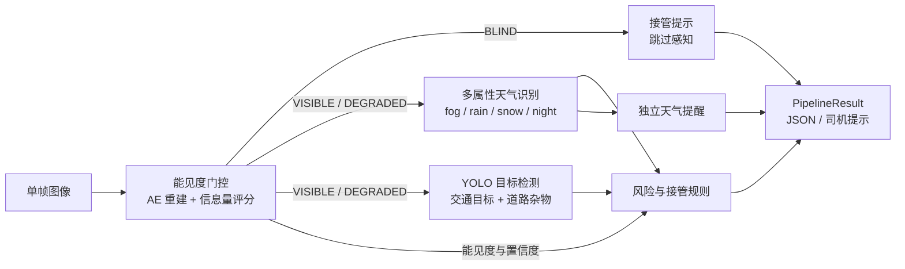

# Car Smart Assist

> 面向恶劣天气与复杂路况的单目视觉驾驶辅助系统

[](#环境要求)
[](#环境要求)
[](LICENSE)
[](https://github.com/XenoWang/Car_Smart_Assist_ACDC)

Car Smart Assist 从单帧道路图像出发，先判断画面是否足以支撑感知，再识别雾、雨、雪、夜间等环境属性，检测交通目标与道路杂物，最后输出风险等级、司机提示和接管请求。

> If you like this project, please support me with a star ⭐

---

## 项目简介

车载单目相机在雨雾、夜间、强遮挡等条件下，画面质量会先于目标识别失效。如果直接运行检测器，系统容易在“什么都看不清”时给出并不可信的结果。本项目围绕这一问题构建了一条可解释、可降级的两阶段链路：

1. **感知（Stage 1）**：能见度门控 → 多属性天气识别 → 目标检测；
2. **决策与提示（Stage 2）**：风险分级 → 接管判断 → 模板化司机提示。

系统对每一帧显式记录可用性、触发原因、证据链和被跳过的阶段。当输入无法可靠判断时，优先请求接管，而不是静默输出猜测。

> 本项目是研究与工程原型，不是量产 ADAS，不能替代驾驶员判断或车辆控制。

## 核心能力

| 模块 | 说明 |
| --- | --- |
| **能见度门控** | 轻量自编码器 + 图像信息量评分，输出 `VISIBLE / DEGRADED / BLIND` 三档；`BLIND` 直接阻断感知并请求接管 |
| **多属性天气识别** | 雾、雨、雪、夜间四个独立属性；MobileNetV3 多层特征 + 属性注意力 + ASL 损失；逐属性校准阈值，支持属性共存 |
| **目标检测** | YOLO11n 检测 car、truck、bus、motorcycle、bicycle、person、rider、train 八类交通目标，并输出道路杂物候选 |
| **风险与接管** | 规则引擎综合目标、天气风险倍率、置信度与可用的距离 / 方向信息；证据缺失时保守请求接管 |
| **可解释输出** | JSON 中包含风险证据、天气概率、检测可用性、跳过阶段与分阶段耗时；提示文案带越权措辞检查 |
| **工程能力** | 固定随机种子、CPU/CUDA 自动选择、批量推理、训练检查点恢复、坏帧逐帧隔离、自动化单元与集成测试 |

## 系统架构



- **门控优先**：能见度不足时不浪费算力运行天气与检测，直接进入失效安全路径。
- **分支独立可降级**：天气、检测任一分支不可用时，结果中会标记 `skipped` 并保留其他分支输出。
- **输入隔离**：损坏或无法解码的帧逐帧记录原因并请求接管，不影响同批其他图片。
- **规则可追溯**：风险等级、接管决定和提示文本都附带可独立验证的证据。

## 评测结果

以下为项目内部开发集结果，用于展示当前实现水平。测试划分在开发过程中被多次查看，不等同于全新未见基准，也不构成实车安全验证。完整的评测协议与结果见 [模型训练与评估报告](model_report.md)。

### 天气属性识别

默认权重，开发测试集 2158 图。四个属性相互独立、可以共存：

| 指标 | 数值 |
| --- | ---: |
| 四属性 macro F1 | **92.55%** |
| 雨 F1 | 89.62% |
| 雾 F1 | 87.82% |
| 雪 F1 | 97.95% |
| 夜间 F1 | 94.82% |

### 目标检测

留出集 1394 图，`imgsz=960`、NMS IoU 0.5、`max_det=100`。mAP 按 AP sweep 计算；道路杂物 P / R / F1 使用各自校准集选出的操作点：

| 指标（%） | 默认权重 | 独立重训候选 |
| --- | ---: | ---: |
| ACDC mAP@50 | 26.91 | **31.55** |
| ACDC mAP@50–95 | 14.78 | **18.85** |
| Lost & Found mAP@50（仅标注 ROI） | 71.48 | **76.00** |
| Lost & Found mAP@50–95（仅标注 ROI） | 41.43 | **46.73** |
| 道路杂物 Precision / Recall / F1 | 82.36 / 59.57 / 69.13 | **82.97 / 64.98 / 72.88** |

独立重训候选尚未替换默认部署权重；Lost & Found 只评估已标注 ROI，不代表整图误报率或任意未知障碍的识别率。

### 能见度门控

合成退化对照，统计最大退化强度下的阻断召回：

| 退化类型 | 阻断召回 |
| --- | ---: |
| 浓雾 | 100% |
| 极暗 | 98.5% |
| 大面积遮挡 | 100% |
| 强模糊 | 86.5% |
| 清晰图误判 BLIND | 0 / 200 |

天气子集本身没有能见度三档真值，因此这些比例只用于验证门控边界，不代表真实场景的驾驶安全准确率。

### 推理性能

RTX 5070，`batch_size=1`，5 张图片，包含三个模型与规则链路：

| 输入方式 | GPU | CPU |
| --- | ---: | ---: |
| 文件路径 | 14.07–14.31 FPS | 8.62–8.89 FPS |
| 预解码数组 | 22.94–23.95 FPS | 11.55–11.86 FPS |

样本量较小，且包含模型构建与预处理开销，不代表车载 30/60 FPS 的部署能力。

## 快速开始

### 环境要求

- Python 3.12
- PyTorch 2.8（仓库默认 CUDA 12.9 构建；CPU 环境可安装对应 CPU 版）
- 主要在 Windows 11 + PowerShell 下验证；Linux / macOS 需将命令中的 `.venv\Scripts\python.exe` 替换为 `.venv/bin/python`

### 安装

```powershell
python -m venv .venv
.venv\Scripts\python.exe -m pip install -r requirements/requirements-torch.txt
.venv\Scripts\python.exe -m pip install -r requirements/requirements.txt
.venv\Scripts\python.exe -m pip install -r requirements/requirements-detection.txt
.venv\Scripts\python.exe -m pip install -e . --no-deps
```

确认 PyTorch 与 CUDA 可用：

```powershell
.venv\Scripts\python.exe -c "import torch; print(torch.__version__, torch.cuda.is_available())"
```

### 数据与权重

仓库不包含数据集与训练权重（见 `.gitignore`）。数据获取与目录结构见 [数据说明](docs/dataset.md)；权重由训练脚本生成，或放置到以下默认路径：

| 模型 | 默认权重路径 | 配置 |
| --- | --- | --- |
| 能见度自编码器 | `artifacts/checkpoints/visibility/best.pt` | `configs/model/visibility.yaml` |
| 天气注意力模型 | `artifacts/checkpoints/weather_attention_ablation/reduced_tuning/best.pt` | `configs/model/weather_default.yaml` |
| YOLO 检测器 | `artifacts/runs/detection/yolo11n_acdc_laf_v2/weights/best.pt` | `configs/model/yolo_detection.yaml` |

YOLO 推理还需要与权重匹配的校准文件，默认位于 `artifacts/reports/detection/yolo11n_acdc_laf_v2/best_class_threshold_v1/calibration.json`。校准缺失或不匹配时，检测分支会被标记为不可用，系统按保守策略请求接管。

### 运行推理

```powershell
# 单张图片，输出结构化 JSON
.venv\Scripts\python.exe scripts\run_pipeline.py --image "图片路径.png" --json

# 多张图片
.venv\Scripts\python.exe scripts\run_pipeline.py --image "a.png" --image "b.png" --json
```

主要输出字段：

| 字段 | 含义 |
| --- | --- |
| `visibility` | 能见度档位、信息量、重建 z 分数、是否允许感知 |
| `weather` | 四属性判定、各属性概率、提醒文本 |
| `weather_warning` | 独立的天气提醒，不直接触发接管 |
| `perception` | 检测目标、检测分支可用性、天气属性 |
| `advisory` | 风险等级、是否请求接管、提示文本、证据链 |
| `skipped` | 本次运行中被跳过或不可用的阶段及原因 |
| `timings_ms` | 各阶段耗时（诊断用途） |
| `blocked` | 是否因能见度 `BLIND` 阻断感知 |

### 运行测试

```powershell
.venv\Scripts\python.exe -m pytest tests -q

# 跳过需要 GPU 的用例
.venv\Scripts\python.exe -m pytest tests -q -m "not gpu"
```

## 训练与评估

### 数据清洗

```powershell
.venv\Scripts\python.exe scripts\clean_data.py --only acdc
.venv\Scripts\python.exe scripts\clean_data.py --only pixel_accurate_benchmark
.venv\Scripts\python.exe scripts\clean_data.py --config configs/data/cleaning_lost_and_found.yaml
```

清洗生成数据可用性清单与报告，不修改或删除原始数据。

### 三个模型

#### 天气属性模型

```powershell
# 训练前检查数据、权重与显存
.venv\Scripts\python.exe -X utf8 scripts\train_weather_attention.py --config configs/model/weather_attention_train.yaml --preflight

# 训练
.venv\Scripts\python.exe -u -X utf8 scripts\train_weather_attention.py --config configs/model/weather_attention_train.yaml
```

训练使用 `weather_attention_train.yaml`，检查点和报告保存到独立实验目录；推理通过 `weather_default.yaml` 选择天气模型及权重。

#### 能见度自编码器

```powershell
.venv\Scripts\python.exe scripts\train_visibility.py --config configs/model/visibility.yaml
```

#### YOLO 检测器

```powershell
.venv\Scripts\python.exe scripts\prepare_detection.py --config configs/data/acdc_lost_and_found_detection.yaml
.venv\Scripts\python.exe scripts\train_detection.py --config configs/model/yolo_detection.yaml
```

#### 串行训练全部模型

```powershell
.venv\Scripts\python.exe scripts\train_pipeline.py --fresh
```

独立重训候选使用 `configs/model/weather_attention_retrain_300.yaml`、`configs/model/visibility_retrain_300.yaml` 与 `configs/model/yolo_retrain_300.yaml`。

### 评估

```powershell
# 天气：训练预算完成后重复训练命令，会重新导出评估结果
.venv\Scripts\python.exe -u -X utf8 scripts\train_weather_attention.py --config configs/model/weather_attention_train.yaml

# 能见度：将检查点路径替换为实际训练产物
.venv\Scripts\python.exe scripts\evaluate_visibility.py --config configs/model/visibility.yaml --checkpoint "<能见度检查点路径>"

# 检测（在 test 划分上评估）
.venv\Scripts\python.exe scripts\evaluate_detection.py --config configs/model/yolo_detection.yaml --split test
```

能见度评估的检查点必须与训练数据清单和划分配置匹配；使用 `--checkpoint` 指定要评估的权重。

端到端性能量测：

```powershell
.venv\Scripts\python.exe -X utf8 scripts\benchmark_pipeline.py --image "图片路径.png" --device auto --warmup 1 --repeats 5 --output artifacts/reports/benchmark
```

### 训练控制

单独模型与串行管线统一支持以下动作：

| 动作 | 行为 |
| --- | --- |
| `--stop` | 当前轮完成训练、验证和保存后停止 |
| `--continue` | 从配对 `last` 恢复，继续原累计目标 |
| `--fresh` | 归档旧产物后，从配置的初始化权重重新训练 |

详见 [统一训练控制](docs/training_stop.md)。

## 项目结构

```text
.
├── configs/                 # 数据、模型与训练配置
│   ├── data/                # 数据集与清洗配置
│   └── model/               # 能见度、天气、YOLO、策略配置
├── docs/                    # 架构、数据、标签与接管策略文档
├── scripts/                 # 数据准备、训练、评估、推理入口
├── src/car_smart_assist/
│   ├── perception/          # 能见度门控、天气模型、YOLO 检测
│   ├── advisory/            # 风险规则、接管判断、提示模板
│   ├── inference/           # 端到端推理管线
│   ├── data/                # 数据集与预处理
│   ├── engine/              # 训练、评估、检查点
│   ├── evaluation/          # 指标与报告
│   ├── config/              # 配置加载与校验
│   └── utils/               # 日志、随机种子、可视化
├── tests/                   # 单元测试与集成测试
├── artifacts/               # 权重、报告、缓存（不入库）
└── data/                    # 原始与处理数据（不入库）
```

## 当前边界与路线图

### 已知边界

- **单目距离与方向尚未实现**：检测器只输出图像坐标框，风险规则中的距离和方向接口暂为未知值；因此检出目标后仍可能因证据不足请求接管。
- **提示生成以规则和模板为主**：本地 VLM 后端的配置与接口已预留，但尚未接入推理链路；模板路径作为长期兜底保留。
- **闭集检测**：只覆盖训练中定义的类别与已标注道路杂物，不能保证识别任意未知障碍。
- **天气识别仍有短板**：总体分数较高，但轻雨、夜间降雨等子场景召回偏低，实际部署应按场景重新评估。
- **无物理量输出**：当前不输出雨量、积水深度或米制能见距离。
- **非实车验证**：所有分数来自项目内部开发集，未经过真实道路闭环或车辆控制验证。

### 路线图

- [ ] 单目目标距离与方向估计（KITTI 标签与几何约束）
- [ ] 学习式接管分类头
- [ ] 语言模型驱动的自然语言驾驶提示（保留模板兜底）
- [ ] 语义分割与多任务感知
- [ ] 真实道路数据闭环与车规级性能验证

## 文档

- [模型训练与评估报告](model_report.md)
- [架构说明](docs/architecture.md)
- [数据说明](docs/dataset.md)
- [标签与接口规范](docs/label_spec.md)
- [风险与接管策略](docs/handover_policy.md)
- [训练控制](docs/training_stop.md)

## 许可证与致谢

代码以 [MIT License](LICENSE) 发布。数据与预训练权重遵循各自提供方的许可条款。

本项目使用并感谢以下开源工作与数据集：

- [ACDC](https://acdc.vision.ee.ethz.ch/)、[Lost & Found](https://wwwlehre.dhbw-stuttgart.de/~sgehrig/lostAndFoundDataset/index.html)、[KITTI](https://www.cvlibs.net/datasets/kitti/)、[Cityscapes](https://www.cityscapes-dataset.com/)
- [PyTorch](https://pytorch.org/)、[Ultralytics](https://github.com/ultralytics/ultralytics)、[timm](https://github.com/huggingface/pytorch-image-models)
