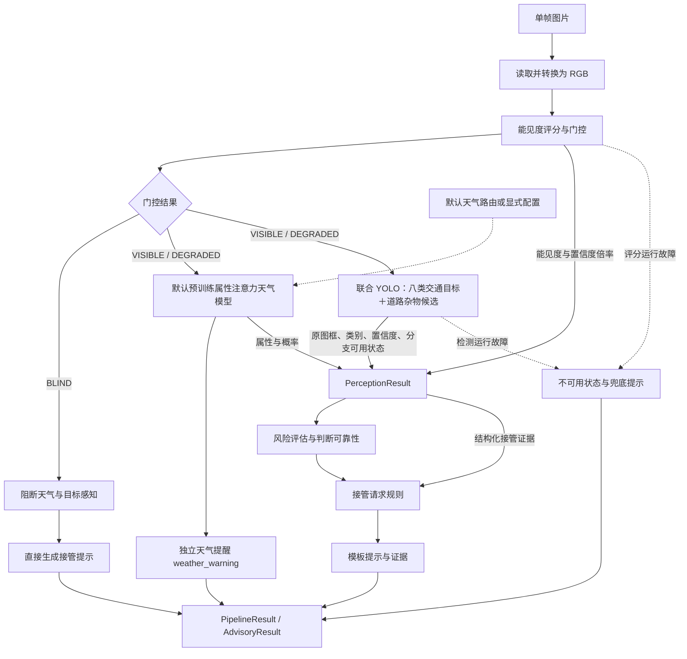
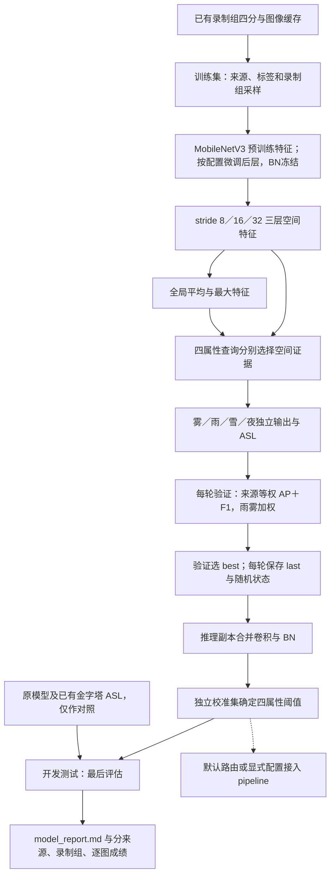
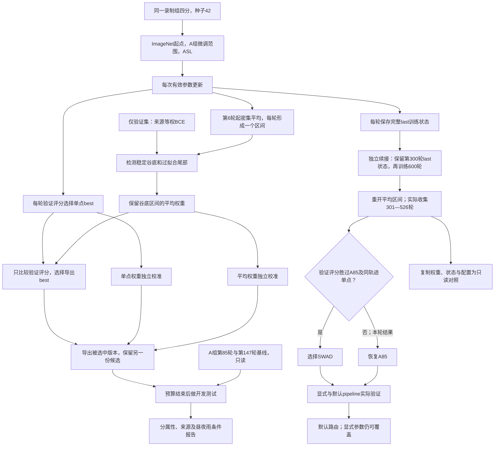

# 架构示意图

## 当前推理链路

天气结果先用来提醒驾驶员；识别到恶劣天气、同时能见度降到 DEGRADED 时，也会给接管规则提供辅助信息。目标风险计算目前仍读旧的天气字段。
YOLO 目前给出检测框，还不预测距离和方向。学习式接管分类头、分割模型和 LLM 也还没接上。

## 预训练属性注意力天气模型

A组配方完成300轮，沿用原500轮学习率计划的前300轮；SWAD另做300轮首轮与600轮续接，累计900轮。验证选权重，校准选阈值，预算结束后再评估开发测试。
推理优化作用于独立副本，训练权重结构不变；天气不确定仍不单独触发接管。

## A 组与 SWAD

300 轮预算及原 500 轮学习率计划保留；谷底结束只停止平均，不提前结束普通训练。BN 继续使用冻结的预训练统计，推理读取一份普通模型，没有线上多模型平均。

默认路由在 `configs/model/weather_default.yaml`。原300轮导出第52轮单点，追加600轮没有刷新这个best；新SWAD验证评分仍不达标，因此默认已按约定恢复A85。两次SWAD及其状态都有只读对照。谷底关闭只停止平均，普通训练仍完成累计900轮；追加学习率从第300轮末值连续衰减，不重置优化器或随机序列。旧雨天残差增强实现和多余权重已删除，旧CNN／金字塔ASL保留对照及共享工具。
