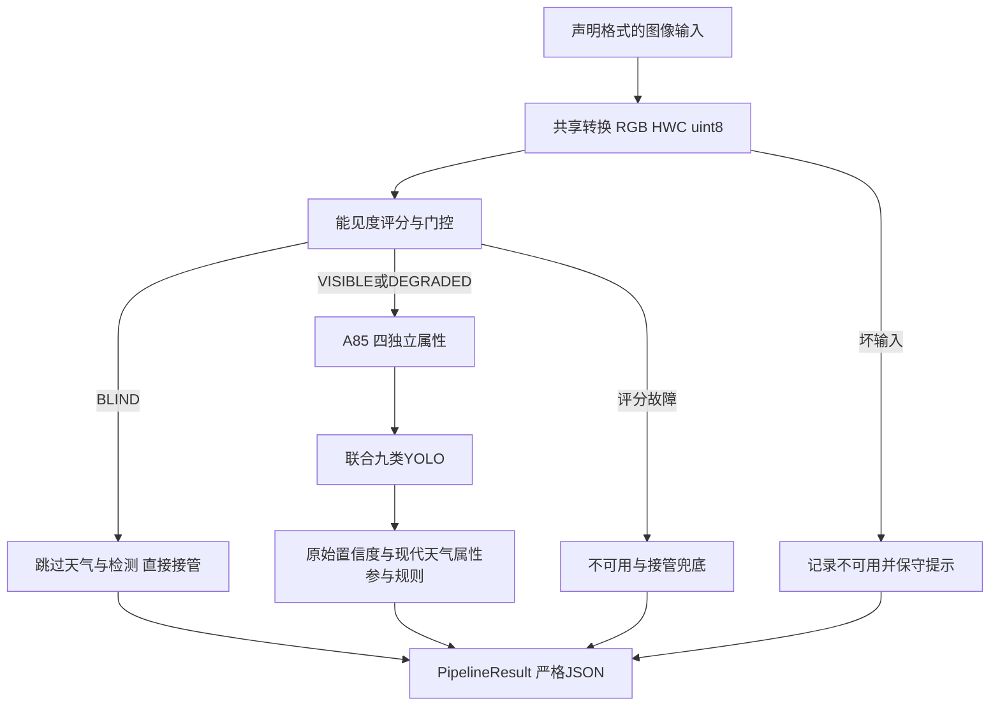

# 当前架构

核对日期2026-11-01；只描述当前有效路由。

## 推理与安全顺序

run_batch仅门控批量评分；天气与检测当前逐帧顺序调用。坏输入单帧隔离、结果等长同序；门控批故障仍整批有效帧兜底。blocked只代表BLIND，不把模块不可用混同为空框或全体blocked。

## 当前模块

- [图像输入](../src/car_smart_assist/data/image_input.py)：所有相机面对入口共享转换；NumPy视图可用自身shape/dtype/stride，原始buffer须声明尺寸/dtype/行跨度，YUV声明矩阵/量化范围，P010/P012位深由格式固定。真实SDK/GPU surface等适配见[边界](camera_inputs.md)。
- [能见度](../src/car_smart_assist/perception/visibility/)：多尺度AE诊断和信息量门控；默认use_recon_z=false，AE仍运行。低信息量BLIND不因缺校准弱化，非有限评分走故障路径。
- [天气](../src/car_smart_assist/perception/weather_attention.py)：默认路由由weather_default.yaml绑定A85；三尺度特征、四属性查询、ASL/known-mask与来源采样已存在。
- [检测](../src/car_smart_assist/perception/joint_yolo.py)：八类交通目标和road_obstacle；保持原最高类别资格、阈值、NMS/数量截断合同及校准身份。失败不静默回退旧模型。
- [策略schema](../src/car_smart_assist/advisory/schema.py)与[规则](../src/car_smart_assist/advisory/policy/)：现代属性优先，取最高基础风险/最大距离倍率；旧road_condition仅缺现代结果时兼容。距离缺失None、方向unknown，当前提示为规则/模板。

## 训练与评估边界

天气推理导出format1、AE训练format3、YOLO完整恢复format5、串行队列state format1各自独立。新权重、校准、数据划分、best身份和pending梯度恢复必须匹配；[停止协议](training_stop.md)为轮末协作，不自动继续用户暂停任务。

ROI指标、合成门控退化与反复查看的开发test均有范围限制，不当实车或未见泛化证据。阶段计时不等于采集到提示完整延迟。距离/方向、分割、学习式接管、LLM/VLM及车辆控制尚未接入。

## 审计与量测入口

天气预测审计、显式checkpoint能见度评估、pipeline JSON证据汇总及benchmark分别服务各自口径；不自动改GT、阈值或默认路由。候选优化须独立核对数值、数据身份和实际性能，不从历史报告推断当前收益。
